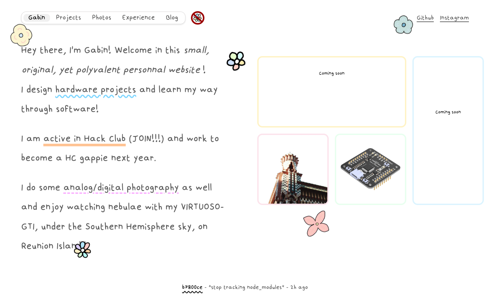
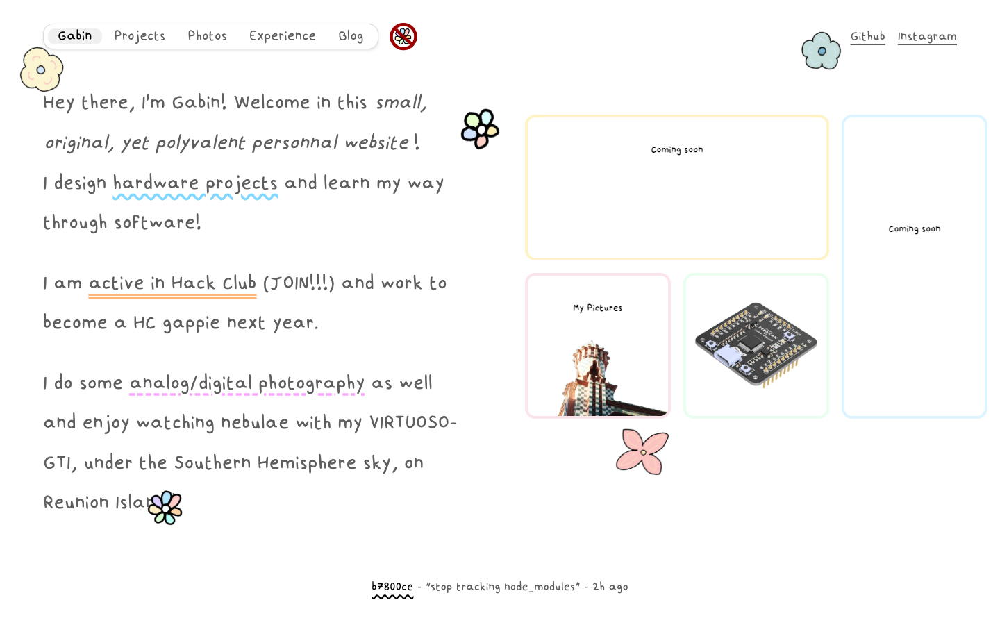
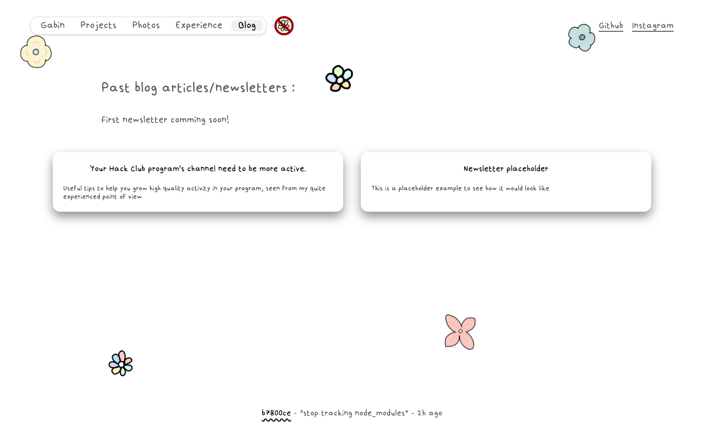
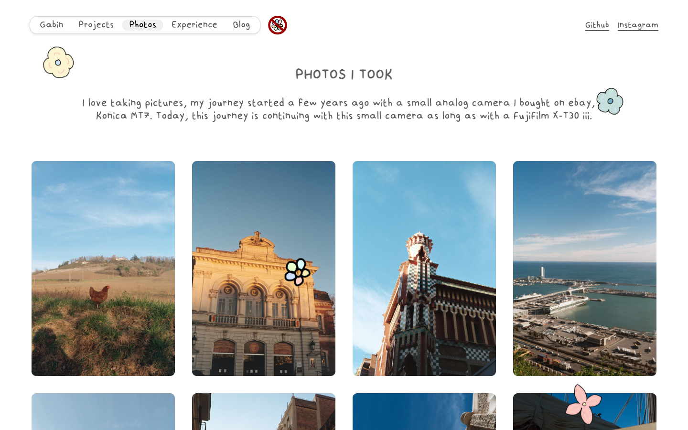
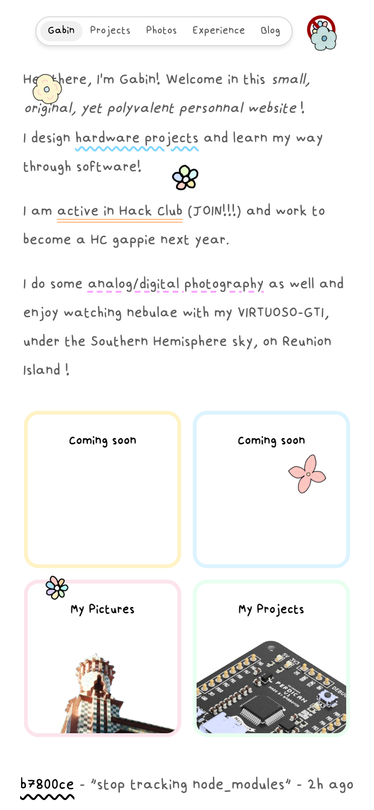

<h1 align="center">
  <br>
  

  <br>
  <a href="https://gabin.gay">gabin.gay</a>
  <br>
</h1>

<h4 align="center">
A cute space for me to showcase my projects, my photos, what i do in my life. You could call this a personnal website!
</h4>

<div align="center">


 +


</div>

<p align="center">
  <a href="#about-the-project">About</a> •
  <a href="#getting-started">Getting Started</a> •
  <a href="#pages">Pages</a> •
  <a href="#screenshots">Screenshots</a> •
  <a href="#repository-structure">Structure</a> •
  <a href="#contributing">Contributing</a> •
  <a href="#license">License</a> •
  <a href="#credits">Credits</a>
</p>

<br>
<p align="center">
  
</p>

## About the Project

**[Gabin.gay](https://gabin.gay)** is my personal website, where I share my hardware projects, my analog photography and (soon) my digital photography as well as my experience/past roles in Hack Club and an article page.

### Features

- **Animated boxes** on the home page that reveal my pictures and projects on hover
- **Photography gallery** with picture details on hover
- **Hand-drawn** cute flowers all over the website, you ca drag and throw them, they'll bounce everywhere!
-**Hand-drawn** custom font, visible all over the website.
- **Markdown-rendered article page** thanks to a js script that transform the md written article in html
- **Commit fetch** in the footer to know the latest update!
- **Fully responsive** layout, it absoluetly works on a phone (but still a bit more shitty than on a computer)
- **Cutie pastel colors** and wavy underlines everywhere bc why not

## Getting Started

To run the site locally you only need [Node.js](https://nodejs.org) (for the blog build).

```sh
# 1. clone the repo
git clone https://github.com/Gabouin/gabin.gay.git
cd gabin.gay

# 2. install the dependencies (only needed for the blog build)
npm install

# 3. serve the site from the repo root
python3 -m http.server 8000
```

Then open [http://localhost:8000/](http://localhost:8000/) in your browser. Use a local server rather than opening the files directly, because some scripts use `fetch` and won't work from `file://`.

### Building the blog

Blog posts are written in Markdown in `pages/posts/*.md`. To turn them into HTML:

```sh
npm run build
```

This generates a `.html` file next to each `.md` file.

## Pages

- `index.html` home page, with the animated boxes
- `projects.html` my hardware and software projects
- `photos.html` my analog photography gallery
- `role.html` my experience at Hack Club and outside of it
- `blog.html` small page with my past articles

## Screenshots

<div align="center">
  <table>
    <tr>
      <td valign="bottom"></td>
      <td valign="bottom"></td>
    </tr>
  </table>
</div>
<div align="center">
  <table>
    <tr>
      <td valign="bottom"></td>
      <td valign="bottom"></td>
    </tr>
  </table>
</div>

## Repository Structure

- `index.html` the home page (kept at the root so GitHub Pages serves it)
- `pages/` the other pages (`projects`, `photos`, `role`, `blog`, `contact`)
- `pages/posts/` blog articles: Markdown sources (`.md`) and the HTML generated from them
- `pages/projects-pages/` one detail page per project
- `css/main.css` the single stylesheet for the whole site
- `js/` scripts: `script.js` (shared behaviour), `projects.js` and `projects-data.js` (projects page), `build.js` (Markdown to HTML for the blog)
- `fonts/` custom font
- `images/` site assets (`analog/` photos, `illustrations/` flowers and badges, `projects/` project images, `readme/` screenshots used in this README)
- `package.json` npm dependencies and the `build` script
- `CNAME` custom domain for GitHub Pages

## Contributing

Suggestions, fixes and ideas are welcome! Please read the [CONTRIBUTING.md](CONTRIBUTING.md) guide to get started.

## License

This project is licensed under the **MIT License**, see the [LICENSE](LICENSE) file for details.

## Credits

This project uses:

- **GitHub Pages** for the hosting
- **[Buttondown](https://buttondown.com)** for the newsletter
- **[Pagering](https://pagering.gideon.sh)** for the webring in the footer
- **Hack Club** yay the community that made me want a website in the first place
- **[chester.how](https://chester.how)** the website I took inspiration from
